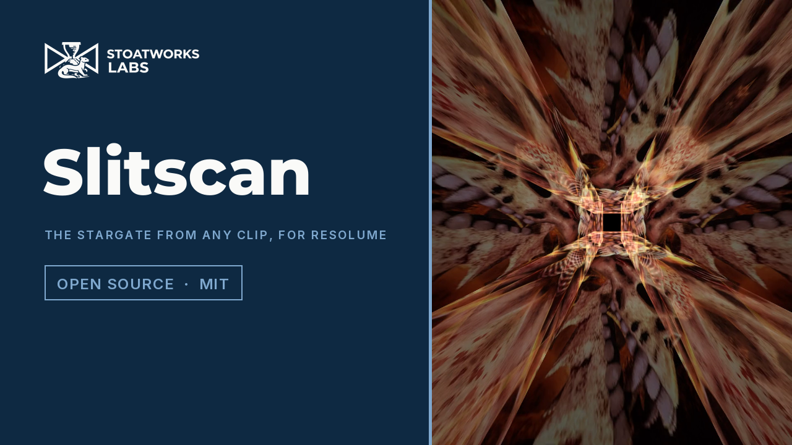

# slitscan

> **AI-assisted project.** This codebase was created with [Claude](https://claude.com/claude-code)
> (Anthropic), directed and reviewed by a human author. Its behaviour is measured rather
> than asserted: an offline harness drives the plugin's own class in a headless GL context
> and checks each claim against a model of its own. A knife-thin scan leaves every pixel
> holding the frame the slit crossed it in, for all six scan shapes, with none wrong out
> of 921 600. A still picture comes through a whole pass bit for bit. Every corridor,
> tunnel and stretch pixel shows the artwork from the moment the dolly's own law says,
> within its derived bound (worst 0.77 of it). 14 negative controls and 27 one-character
> mutants prove the checks can fail. On Windows it loads and renders in **Resolume Arena** on
> software rendering, with every control as declared; it has **never been loaded into Resolume
> on macOS**. The full rundown is under [Status](#status).

Slit-scan and strip photography, as an FFGL effect for [Resolume](https://resolume.com)
Arena and Avenue: the phone filter that stretches your face, Trumbull's Stargate corridor
from *2001*, the *Doctor Who* title tunnel and the *Star Trek* warp stretch, all from
whatever clip you put through it.


<sub>Rendered by `sxtest`, the offline harness, not captured from Resolume. Resolume's
bundled `IntoTheGlow_02`, 1.67 s in at 60 fps. Clockwise from top left: Corridor with
Walls on Four, Tunnel with a Square outline, Scan sweeping Down in 1.05 s, and Stretch
with the settings under [Stretch](#stretch-knoll).</sub>

<!-- downloads:start -->

## Download

**[v0.1.0](https://github.com/stoatworks-labs/slitscan/releases/tag/v0.1.0)** — prebuilt for macOS and Windows. Pick your platform:

<details>
<summary><b>macOS</b> — Universal (Apple Silicon + Intel)</summary>

| Build | Download | Size |
| --- | --- | --- |
| Universal (Apple Silicon + Intel) · .dmg disk image | [`slitscan-0.1.0-macos-universal.dmg`](https://github.com/stoatworks-labs/slitscan/releases/download/v0.1.0/slitscan-0.1.0-macos-universal.dmg) | 223 KB |
| Universal (Apple Silicon + Intel) · .zip archive | [`slitscan-macos-universal.zip`](https://github.com/stoatworks-labs/slitscan/releases/latest/download/slitscan-macos-universal.zip) | 182 KB |

</details>

<details>
<summary><b>Windows</b> — x64</summary>

| Build | Download | Size |
| --- | --- | --- |
| x64 · .exe installer | [`slitscan-0.1.0-windows-x86_64-setup.exe`](https://github.com/stoatworks-labs/slitscan/releases/download/v0.1.0/slitscan-0.1.0-windows-x86_64-setup.exe) | 227 KB |
| x64 · .zip archive | [`slitscan-windows-x86_64.zip`](https://github.com/stoatworks-labs/slitscan/releases/latest/download/slitscan-windows-x86_64.zip) | 119 KB |

</details>

All builds, checksums and release notes: [github.com/stoatworks-labs/slitscan/releases](https://github.com/stoatworks-labs/slitscan/releases).

macOS builds are signed and notarised and open normally. The Windows builds are unsigned, so SmartScreen warns once.

<!-- downloads:end -->

## Video

[](https://www.youtube.com/watch?v=uUYth8S6Hvk)

## The one idea

**A slit-scan picture is one long exposure, taken while something moves.**

The shutter stays open and a slit decides which bit of the film can see out. Then
something moves: the slit, the camera, or the artwork behind the slit. Each point of the
film is only exposed while the slit lies over it, so each point records a different
moment of the move. Time turns into space, and nobody had to warp anything.

That's the whole trick, and the plugin does the arithmetic of it. For every pixel it
works out when it was exposed and what it could see at that moment.

There are two ways round, and the video that started this
([ShiveringCactus, *VFX History: Slit Scan*](https://www.youtube.com/watch?v=qKOAOzVHvFQ))
covers both:

- **The slit at the film** (strip photography). The scene stays put and a slit sweeps
  across the film in front of it. Each line of the picture is a different instant. That's
  the phone filter, the focal-plane shutter and the rolling shutter.
- **The slit at the subject** (slit-scan proper). A slit sits in front of backlit artwork,
  a camera dollies towards it with the shutter open, and the artwork slides along behind
  it. As the camera closes in, the slit's image sweeps outwards across the film, so each
  point of the picture is a different distance from the camera: a different depth. The
  artwork lands on the walls of a corridor in perfect perspective, because perspective is
  what a camera at that distance does. Douglas Trumbull built a machine to do this for
  *2001*. The plugin does it once a frame.

## The modes

### Scan (the phone filter)

A slit sweeps the frame Down, Up, Right, Left, Clockwise (a hand from twelve o'clock) or
Outward (a ring from the centre), once every Scan Time or in step with Resolume's beat.
Behind it the picture is whatever the slit saw on its way past; ahead of it is the live
clip, the last pass or black. Give the slit some width and each pixel averages the frames
it was under the slit for, in linear light, as film would.

What falls out:

- **A still picture passes through unchanged.** Nothing moved, so there's nothing for the
  slit to record.
- **Things moving sideways lean.** That's the rolling-shutter lean: v/s pixels per row,
  for something moving at v under a slit moving at s.
- **Things moving with the slit stretch, and against it shrink.** A face drifting down
  with a Down scan is recorded h·s/(s − v) tall, which is why the filter makes chins
  three feet long.

### Corridor (Trumbull)

One, two or four straight slits, a camera dollying from Depth times its closest distance
down to its closest, and the clip sliding along behind the slits as it goes. A pixel at a
given distance from the vanishing point was exposed at the one moment the slit's image
passed it, so:

- **The walls are in perfect perspective.** The artwork's rows run to the vanishing point,
  and nothing was drawn to make them.
- **The far end glows.** With Dolly on Constant Speed the slit's image crawls while the
  camera is far away and races once it's close, so the far end of the corridor gets the
  most light, as Trumbull's did. Even Exposure closes in geometrically instead and lights
  every depth the same.
- **The walls stream past.** Flow moves where the artwork starts from one frame to the
  next, so the corridor flies by. It runs in beats or bars if you'd like the Stargate to
  keep time.

### Tunnel (Lodge)

The slit is an outline (circle, square, diamond or hexagon) instead of a pair of lines,
which is how Bernard Lodge built the *Doctor Who* titles. Every ring of the tunnel is the
outline's shape. Lines in the artwork that run the way it travels shear into diagonals
down the tunnel walls, as his did.

### Stretch (Knoll)

Here the clip is the subject rather than the backing. A strip of light sweeps across it
while the camera dollies in, so whatever gets lit late is drawn large and whatever got lit
early sits small, towards the vanishing point. That's John Knoll's warp stretch for *The
Next Generation*. A wide strip smears each column out along its ray.

The defaults are set up for the corridor, and on them Stretch is a dim wedge (which is
what the physics gives you). For the warp, set Dolly to **Even Exposure**, Depth to about
6 (0.28 on the slider), Exposure to about +1.6 stops (0.7) and Centre X to 0.2.

## Controls

| Group | |
| --- | --- |
| **Camera** | Mode (Scan, Corridor, Tunnel, Stretch). |
| **Scan** | Direction (Down, Up, Right, Left, Clockwise, Outward), Scan Time (one pass, 0.25–30 s), Scan Sync (Free, Beat, Bar, 2 Bars, 4 Bars), Ahead (Live, Last Pass, Black: what you see where the slit hasn't been yet), Repeat (Loop, Once), Restart (start a pass now, or on the next boundary when synced), Slit Line (how bright the slit's line is drawn). |
| **Slit** | Walls (Two, One, Four), Outline (Circle, Square, Diamond, Hexagon), Gap (the unexposed hole round the vanishing point), Slit Height (how tall the slit is, which sets how steeply the walls' edges run in), Slit Width (0 is knife-thin), Depth (the camera's farthest distance over its closest, 1.5–200), Dolly (Constant Speed, Even Exposure), Exposure (−4 to +4 stops), Roll (0–360°), Centre X, Centre Y (the vanishing point, or the centre of a Clockwise or Outward scan). |
| **Artwork** | Travel (how far the artwork slides during one exposure, 0.05–8 clip widths), Art Angle (which way it slides, 0–360°), Flow (−2 to +2 clip widths a second, beat or bar), Flow Sync (Free, Beat, Bar), Wrap (Mirror, Repeat). |
| **Output** | Mix. |

Not every control acts in every mode:

- **Scan** reads the Scan group, Slit Width (a share of the pass), Mix, and Centre X and Y
  for a Clockwise or Outward scan.
- **Corridor** and **Tunnel** read the Slit and Artwork groups, except that Walls and
  Slit Height are Corridor's and Outline is Tunnel's.
- **Stretch** reads Slit Width (the strip of light, as a share of the clip), Depth, Dolly,
  Exposure, Roll, Centre X and Y, and Mix. The clip is the subject, so the Artwork group
  has nothing to move.

The defaults are a Stargate: Corridor with two walls, a camera that starts 60 times
further away than it ends, at constant speed, a slit a fiftieth as wide as it is far off
the axis, and the clip sliding one width per exposure and flowing a quarter of a width a
second.

## Status

**v0.1.0**, the first release. Measured offline on one Mac, and run in Resolume Arena on
Windows. There's a [user guide](https://stoatworks-labs.com/software/slitscan/guide/).

### Measured offline, on macOS

`tools/verify.sh` passes on this machine (Apple Silicon, macOS 26) against a fresh
universal Release build. It runs every picture check at **two rasters**, 1280×720 and
320×180, and again on **Apple's software renderer** at 320×180. What it establishes:

| check | result |
| --- | --- |
| `--still` | a still picture through a whole pass, all six directions, knife-thin and 0.02 wide: **0 bytes** differ, both rasters |
| `--timecode` | a card that is a different flat value every frame: after a knife-thin pass, **0 of 921 600** pixels hold the wrong frame in each straight direction at 1280×720 (Clockwise and Outward: 0 wrong, with 225 and 108 too near a frame boundary to call); a slit 0.1 wide gives each pixel the linear-light mean of the frames it was under for, worst 0.57 of its bound; Ahead's Live, Last Pass and Black ahead of a half-done pass, 0 pixels wrong |
| `--skew` | a bar crossing at 8 px a frame under 16 rows a frame leans 0.49 px a row (v/s = 0.5); a bar moving with the slit at half its speed is recorded 160 rows (h·s/(s − v) = 160), and against it 48 (53.3, and the frame schedule says 48) |
| `--turns` | the scan's coordinate in all six directions against `atan2` and `hypot` in double: worst 1.8e-7, 0.18 of its bound (the clockwise angle is a polynomial good to 2e-8 rad) |
| `--sync` | free passes take Scan Time; synced passes are the bar's own fraction at 1/4, 1, 2 and 4 bars; each frame's travel starts where the last ended; Once holds, and Restart restarts at once when free and on the next bar when synced: **0 problems** in 900 frames each |
| `--perspective` | Corridor on a coordinate card, one, two and four walls, both dolly laws: every wall pixel shows the artwork at the moment the dolly's forward law (solved independently by bisection) puts the slit's image there, worst **0.77** of its bound; every pixel off the walls is black |
| `--exposure` | flat white artwork: a knife-thin slit's light against the dwell in closed form, worst 0.00 of its bound (Constant Speed from 1.70 at the far end to 0.05 at the near; Even Exposure 1.000 everywhere); a slit 0.2 wide against its exposure window, worst 0.15 |
| `--tunnel` | circle, square, diamond and hexagon, rolled 30°, artwork travelling at 30°: every level set of the time map is the outline's shape, worst **0.77** of its bound |
| `--stretch` | knife-thin, rolled 45° and off centre, and Even Exposure solved in 16 pieces: every lit pixel shows the card point the strip lit, at its place over the camera's distance then, worst 0.46 of its bound; a strip 0.2 wide against a brute-force sum, worst 0.36 |
| `--flow` | Flow per second, beat and bar, and across ten frames of Scan in the middle: the artwork has moved what the clock says, worst 0.57 of its bound |
| `--clock` | a host clock 499 217 238 ms into its session renders the same take as one starting at 0: Scan to the bit, Corridor within 1e-5 (the artwork's start reaches the GPU as a float) |
| `--resize` | the raster drops from 960×540 to 320×180 half way through a pass: **0** pixels hold the wrong frame afterwards |
| `--state` | the host's GL state comes back, in all four modes, across a resize |
| `--negative` | **14** deliberately wrong models, **14** caught |
| mutation | **27** one-character mutants of the shipped GLSL and C++, **27** caught |
| `tools/sweep.py` | all **25** controls measurably change the picture |
| shaders | all 6 compile through `glslc`, not only through Apple's driver |
| the bundle | universal (`x86_64 arm64`), exports `plugMain`, ad-hoc signs; `oxbow` reports `SW Slitscan` / `SX01` / `effect` and renders 120 frames through `plugMain` |

Each bound is worked out from what can legitimately move a pixel: half-float rounding,
the mip level the artwork is read at, and the 8-bit weights of the texture filter. Pixels
whose filter reaches the edge of the artwork are left out rather than given a looser bound.

On Apple's software renderer the frame values come back up to two float bits off the
card's, because its bilinear filter is a hair off at a texel centre and its half-float
film holds more than half a float. Frame checks allow 2⁻²⁰ for that, a thousandth of the
gap between any two frames.

### In Resolume Arena, on Windows

The fleet's Arena gate (`arena/` in plugin-bench) ran the release workflow's own Windows build
in **Resolume Arena 7.27.1** on win-lab, a Windows VM with no GPU (Mesa's llvmpipe), twice. Both
times the DLL loads and registers as `SW Slitscan`, `SX01`, an effect; all 31 controls (Arena's
Opacity and the plugin's 30) arrive with the names, order, types, ranges and defaults declared;
it renders; and Arena's log stays clean: **9 passed, 0 failed, 1 skipped**.

Against Arena's still test picture, with Flow at 0 so the rig stands still, 17 of the plugin's
controls measurably changed the frame, including every control that acts in Corridor, Tunnel
and Stretch. Scan's Direction, Ahead, Repeat and Slit Line came out inconclusive. Scan hands a
still picture back unchanged, which is the point, and the gate reads a frame identical to its
input as Arena's habit of leaving an effect out of a thumbnail. Read straight off Arena's REST
API instead, Ahead on Live gave the still back to the pixel bar the slit's own row, Ahead on
Black blacked out everything the slit hadn't reached and shrank as the slit came down, Right
moved the black to the side, and Slit Line drew its line. Scan Time, Scan Sync and Flow Sync
only set a pace, which stills can't measure; Restart is a button. Software rendering says
nothing about a GPU, or about speed.

### Cost

Render cost, GPU time by `GL_TIME_ELAPSED`, median of 120 frames after a warm-up, on a
GPU shared with other work, so the small numbers wobble from run to run: at the defaults,
**0.06 ms** at 720p, **0.28 ms** at 1080p and **1.19 ms** at 4K. The heaviest case
tried, Corridor with four walls and a slit 0.3 wide, is **0.27**, **0.76** and
**3.53 ms**. Tunnel and Stretch with a wide slit come between (up to 2.1 ms at 4K), and
Scan is the cheapest (0.91 ms at 4K). macOS figures only.

### Not established

It's **never been loaded into Resolume on macOS**: on a Mac it has only been measured
offline against the plugin's own class in a headless CGL context, plus an `oxbow` load. On
Windows, Arena has only run it on software rendering, on a still picture. Nobody has seen how
Scan Sync and Flow Sync follow Arena's transport, what a GPU other than this Mac's makes of
it, or what Resolume's own clips do to the frame rate at 4K. There are no presets.

Corridor and Tunnel treat the artwork as a flat backlit card and the slit as perfectly
sharp, as the real rigs did near enough. Stretch's card fills the frame at the camera's
closest. AGENTS.md lists what else is assumed.

## Browser demo

**<https://slitscan-demo.stoatworks-labs.com/>**: all four modes, every control with its own
name, group and default. The shaders are the plugin's own GLSL, spliced unedited
(`demo/tools/check_shaders.py`, run by `tools/verify.sh`); the CPU half is a JavaScript port,
and `demo/tools/crosscheck/` renders it and `sxtest` over the same frames: in eleven cases
across all four modes every pixel is within one level of the plugin's, and every Scan case is
identical to the bit. It is a demo, not the plugin, and says what it leaves out.

## Build

macOS (universal: Apple Silicon and Intel):

```bash
git clone --recurse-submodules https://github.com/stoatworks-labs/slitscan
```

```bash
cmake -B build -DCMAKE_BUILD_TYPE=Release
```

```bash
cmake --build build
```

```bash
cmake --install build
```

The last one copies `Slitscan.bundle` into `~/Documents/Resolume Arena/Extra Effects`.
Restart Arena and it's under Effects as **SW Slitscan**.

Windows needs Visual Studio 2022 and vcpkg (for GLEW); see `.github/workflows/ci.yml`.

## Building and testing

```bash
tools/verify.sh
```

That's everything: a fresh universal build, every check at two rasters and on the
software renderer, the negative controls, the mutants, the sweep for dead controls, the
bundle's architecture and plist, an ad-hoc signature, a host's view of it through
`oxbow`, and the render cost. `CLAUDE.md` lists the checks one by one.

Render a frame of your own:

```bash
./build/sxtest --out /tmp/slitscan.png --set "Mode=Tunnel" --set "Outline=Hexagon"
```

Or put a clip through it:

```bash
ffmpeg -i in.mov -vf fps=60 -f rawvideo -pix_fmt rgba - | ./build/sxtest --pipe --size 1920x1080 --set "Mode=Scan" | ffmpeg -f rawvideo -pix_fmt rgba -s 1920x1080 -r 60 -i - out.mp4
```

## License

MIT. See [LICENSE](LICENSE) and [ATTRIBUTIONS.md](ATTRIBUTIONS.md).

<!-- attributions:start -->
This project is built on other people's work — see [ATTRIBUTIONS.md](ATTRIBUTIONS.md).
<!-- attributions:end -->
